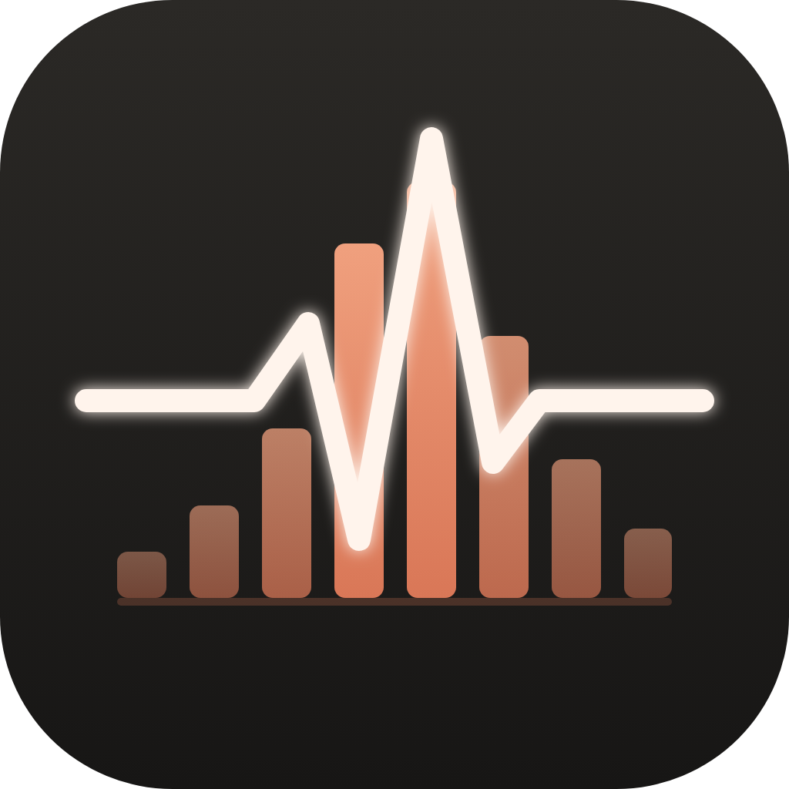

# Pulse Bar

A Claude Code mod that adds a single live row just above the prompt, so you can see what Claude is doing at a glance:

```
◐ Bash 0:07 · turn 0:42 │ 12 prompts · 48 tools · 2 ✗ · 37m │ ▁▁▂▁▃▅█▆▃▁▁▂▄▇█▅▂▁▁▁▁▃▅▇  more
```

- **Live activity** – a spinner while a turn runs, the tool in flight (with `+N` for parallel calls), how long that tool has been running, and the turn's elapsed time. Between turns it shows `idle · last turn m:ss`.
- **Session stats** – prompts sent, tool calls, failed or denied calls (`✗`), and session length.
- **Tool sparkline** – tool calls per 10-second bucket over the last 4 minutes, newest on the right. It's drawn as a colored raster in the terminal and as block characters in the desktop and mobile apps.
- **more / less** – toggles a second line listing your most-used tools this session.

Stats are per session: nothing is written to disk and nothing leaves your machine. The mod only observes. If one of its hooks fails, your prompts and tool calls carry on untouched.

On a narrow window the row drops the sparkline (under 72 columns), then the stats (under 44 columns), and keeps the live state.

## Install

At the prompt of a Claude Code terminal session:

```
/plugin install pulse-bar --marketplace aaronsells/-aaronsells-pulse-bar
```

Answer `y` to add the marketplace, then pick a scope (user scope loads it in every session).

From a shell:

```
claude plugin install pulse-bar --marketplace aaronsells/-aaronsells-pulse-bar
```

In the desktop app: click **+** next to the prompt box → **Plugins** → **Add marketplace** with `aaronsells/-aaronsells-pulse-bar`, then **Add plugin**.

## Develop

```
claude --plugin-dir .          # run it from this folder; edits hot-reload
claude plugin validate .       # check the manifest and hooks module
claude plugin test .           # run tests/*.test.tsx
```

| File | What it is |
| --- | --- |
| `.claude-plugin/plugin.json` | manifest |
| `.claude-plugin/marketplace.json` | makes this repo installable with `/plugin install` |
| `hooks/register.tsx` | the hooks module: event tracking and the band's drawing |
| `types/index.d.ts` | the `$.state` contract for the values the band reads |
| `tests/pulse-bar.test.tsx` | tests across the terminal, desktop and mobile surfaces |

Mods use Claude Code's function-hooks API, which is in early access and may change between releases.

## License

MIT, see [LICENSE](LICENSE).
